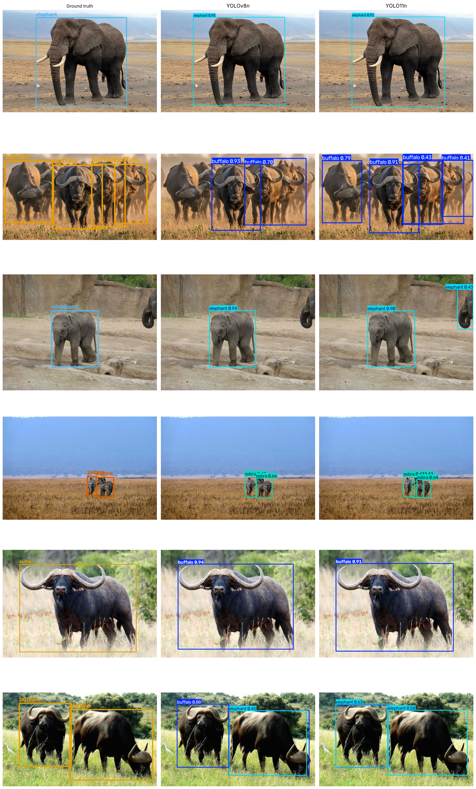

# Detecção de Objetos com YOLO — YOLOv8n vs YOLO11n

Implementação, treinamento e comparação de duas versões do YOLO na base de dados **African Wildlife**.

📓 Notebook: [`YOLO_v8_vs_v11_African_Wildlife.ipynb`](YOLO_v8_vs_v11_African_Wildlife.ipynb)

## Base de dados

[African Wildlife](https://docs.ultralytics.com/datasets/detect/african-wildlife/): imagens de animais da savana africana com 4 classes: `buffalo`, `elephant`, `rhino` e `zebra`.

| Divisão | Imagens |
|---|---|
| Treino | 1.052 |
| Validação | 225 |
| Teste | 227 |

## Metodologia

- **Modelos:** YOLOv8n (2023) e YOLO11n (2024), variante *nano*, partindo de pesos pré-treinados no COCO (*transfer learning*).
- **Biblioteca:** [Ultralytics](https://github.com/ultralytics/ultralytics).
- **Hiperparâmetros iguais para os dois modelos:** 12 épocas, imagens de 320 px, batch 16, seed 0 (treino em CPU).
- **Avaliação:** conjunto de teste, que não foi usado no treino.

## Resultados (conjunto de teste)

| Modelo | Precisão | Recall | mAP@50 | mAP@50-95 | Parâmetros | Inferência (CPU) |
|---|---|---|---|---|---|---|
| YOLOv8n | **0,944** | **0,903** | **0,966** | **0,791** | 3,14 M | 20,0 ms/img |
| YOLO11n | 0,913 | 0,900 | 0,951 | 0,769 | **2,61 M** | **16,7 ms/img** |

**mAP@50-95 por classe:**

| Classe | YOLOv8n | YOLO11n |
|---|---|---|
| buffalo | 0,842 | 0,796 |
| elephant | 0,758 | 0,750 |
| rhino | 0,868 | 0,860 |
| zebra | 0,697 | 0,669 |

### Predições com bounding boxes

Colunas: anotação original (*ground truth*), YOLOv8n e YOLO11n.

## Conclusão

- Os dois modelos aprenderam bem a tarefa: mAP@50 acima de 0,95 com poucas épocas, graças ao *transfer learning*.
- Com o treino curto, o **YOLOv8n foi um pouco mais preciso** (+2,2 pontos de mAP@50-95) e melhor nas 4 classes. As curvas de validação dos dois ainda estavam subindo na época 12, então com mais épocas o resultado pode mudar.
- O **YOLO11n é ~17% menor e ~16% mais rápido**, com qualidade bem próxima. É a melhor escolha quando a velocidade importa.
- A classe mais difícil foi **zebra**, que costuma aparecer pequena e em grupo. Os dois modelos também erram em manadas densas de búfalos.

## Como executar

Abra o notebook no [Google Colab](https://colab.research.google.com/), ative a GPU (*Ambiente de execução → Alterar tipo de ambiente → T4 GPU*) e execute todas as células. Com GPU, o notebook usa automaticamente 50 épocas e imagens de 640 px.
